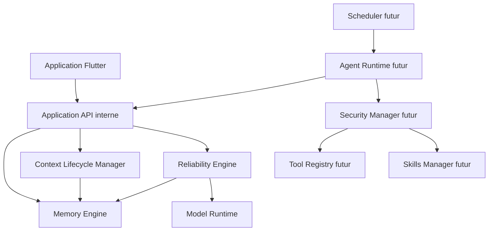

# Living Memory — Architecture Master Plan

Référence V1 : `0f95b7eb`. Reprise V1.1 : `89de7bd6`. Mission du 26 octobre 2026, exécution autonome autorisée.

## Frontières

Memory Engine : SQLite existant et migration additive, sources V1 inchangées, souvenirs versionnés, archives de sessions séparées. Model Runtime : conserver les ports ConversationRepository et EmbedderService ; ne jamais changer le profil d'embedding implicitement. Context Lifecycle : archivage transactionnel, budget conservateur, checkpoints extractifs, restauration par portée. Reliability : recherche hybride FTS5/cosinus, validation des citations, abstention structurée, pas de promotion des réponses IA.

Contrats futurs dans `lib/living_memory/module_contracts.dart` : scope explicite utilisateur/agent/projet/monde, résultat d'outil distinct de texte généré, permission préalable aux effets sensibles, exécution annulable et reprise par identifiant. Aucun serveur, téléchargement de code, exécution de Skills tiers ou service Android ajouté en V1.1.

## Invariants

- Un candidat et une réponse générée restent des affirmations non vérifiées. Confirmation humaine ≠ vérification externe.
- Les archives ne deviennent pas des souvenirs par compaction. Supprimer un contexte actif ne supprime aucun document/souvenir permanent.
- Les identifiants de session sont liés à leur portée complète. Une autre portée ne peut ni lire ni modifier cette session.
- Les modèles natifs existants sont réutilisés séquentiellement. Ne pas promettre leur déchargement ou un budget RAM sans mesure physique.
- Le modèle ne choisit jamais une autorisation ni un statut de résultat d'outil.
- V1 ne possède pas d'authentification multiutilisateur. Le champ utilisateur des contrats est un namespace, pas une barrière de sécurité Android.

## Migration

Schéma 2 -> 3 : index FTS5 des passages, synchronisation par triggers, tables de sessions/messages/checkpoints, associations projet/monde aux documents. Transaction unique, reprise sans réindexation des vecteurs. Version future refusée avant écriture. Sauvegarde/restauration externe et chiffrement restent des travaux futurs ; ne pas désinstaller une V1 pour contourner une incompatibilité de certificat.

## Livraisons

V1.1 : compléter le moteur existant, sessions persistantes et Centre de mémoire, FTS5 et garde de citations. V1.2 : export/restauration testés, clé de signature pérenne, réindexation explicite et gestion mémoire des runtimes. V1.3 : Agent Runtime, permissions et outils Android en liste autorisée. V1.4 : Scheduler/WorkManager et Foreground Service après étude des restrictions Android ; API locale authentifiée sans exposition réseau par défaut. Living World AI réutilise les mêmes interfaces avec une portée monde, sans confondre observations simulées et faits du monde réel.

## Plan d'implémentation

1. Tests SQLite : migration, FTS5 et isolation, archive/compaction/restauration, refus de citation absente, archivage des souvenirs.
2. Migration additive et API de sessions, ContextLifecycleManager et ReliabilityEngine testables sans modèle natif.
3. Contrats des extensions ; branchement du RAG hybride et archivage des échanges dans l'écran V1 ; UI de sessions et archivage des souvenirs.
4. Tests Flutter ciblés puis suite complète, analyse, format, APK Actions ; rapport fondé uniquement sur les résultats observés.

Points de revue : source supprimée pendant recherche ; JSON/document hostile ; budget insuffisant ; interruption après question avant réponse ; collisions de session entre projets ; migration depuis V1 et V1.1 ; négation tronquée dans une citation. La citation garantit la correspondance textuelle uniquement, pas l'implication logique.
